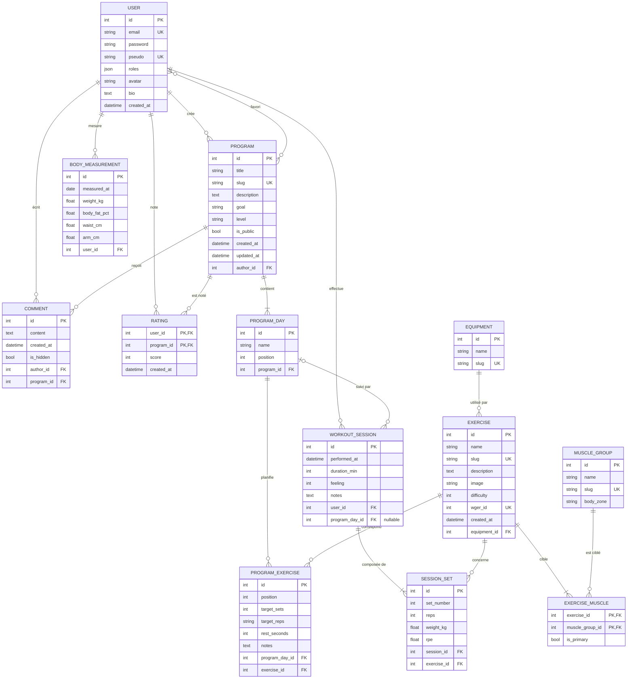

# SpotMe : Modèle Conceptuel de Données (MCD)

## 1. Règles de gestion

1. Un **utilisateur** peut créer 0 ou plusieurs **programmes**. Un programme a un seul auteur.
2. Un programme contient au moins 1 **jour** (ex. « Push », « Jour A »). Un jour appartient à un seul programme.
3. Un jour de programme planifie 0 ou plusieurs **exercices planifiés**, avec des séries, répétitions et un temps de repos cibles. Chaque exercice planifié fait référence à un seul **exercice** du catalogue.
4. Un exercice cible au moins 1 **groupe musculaire**. Pour chaque muscle, on précise s'il est **principal** ou **secondaire**.
5. Un exercice utilise un seul type de **matériel** (barre, haltères, machine, poids du corps…).
6. Un utilisateur effectue 0 ou plusieurs **séances**. Une séance peut suivre un jour de programme, ou être une séance libre.
7. Une séance est composée d'au moins 1 **série réalisée** (exercice, répétitions, charge).
8. Un utilisateur peut **commenter**, **noter** (de 1 à 5, une seule note par programme) et **mettre en favori** les programmes publics.
9. Un utilisateur peut enregistrer 0 ou plusieurs **mensurations** (poids, % de masse grasse…).
10. Un utilisateur a un ou plusieurs rôles : `ROLE_USER` et, s'il est administrateur, `ROLE_ADMIN` pour accéder au Back-Office.

## 2. Entités et attributs

| Entité | Attributs (identifiant **souligné** = `id`) |
|---|---|
| **USER** | <u>id</u>, email *(unique)*, password *(haché)*, pseudo *(unique)*, roles, avatar, bio, created_at |
| **MUSCLE_GROUP** | <u>id</u>, name, slug, body_zone *(haut / bas / tronc)* |
| **EQUIPMENT** | <u>id</u>, name, slug |
| **EXERCISE** | <u>id</u>, name, slug, description, image, difficulty *(1-3)*, wger_id *(unique, nullable : lien vers l'API wger)*, created_at |
| **PROGRAM** | <u>id</u>, title, slug, description, goal *(force / hypertrophie / sèche / endurance)*, level *(débutant / intermédiaire / avancé)*, is_public, created_at, updated_at |
| **PROGRAM_DAY** | <u>id</u>, name, position |
| **PROGRAM_EXERCISE** | <u>id</u>, position, target_sets, target_reps *(ex. « 8-12 »)*, rest_seconds, notes |
| **WORKOUT_SESSION** | <u>id</u>, performed_at, duration_min, feeling *(1-5)*, notes |
| **SESSION_SET** | <u>id</u>, set_number, reps, weight_kg, rpe *(nullable)* |
| **COMMENT** | <u>id</u>, content, created_at, is_hidden *(modération)* |
| **BODY_MEASUREMENT** | <u>id</u>, measured_at, weight_kg, body_fat_pct, waist_cm, arm_cm |

## 3. Associations et cardinalités (notation Merise)

| Association | Entité A | Card. A | Card. B | Entité B | Attributs portés |
|---|---|---|---|---|---|
| CRÉER | USER | 0,n | 1,1 | PROGRAM | |
| CONTENIR | PROGRAM | 1,n | 1,1 | PROGRAM_DAY | |
| PLANIFIER | PROGRAM_DAY | 0,n | 1,1 | PROGRAM_EXERCISE | |
| CORRESPONDRE | EXERCISE | 0,n | 1,1 | PROGRAM_EXERCISE | |
| CIBLER | EXERCISE | 1,n | 0,n | MUSCLE_GROUP | **is_primary** |
| UTILISER | EXERCISE | 1,1 | 0,n | EQUIPMENT | |
| EFFECTUER | USER | 0,n | 1,1 | WORKOUT_SESSION | |
| SUIVRE | WORKOUT_SESSION | 0,1 | 0,n | PROGRAM_DAY | |
| COMPOSER | WORKOUT_SESSION | 1,n | 1,1 | SESSION_SET | |
| CONCERNER | SESSION_SET | 1,1 | 0,n | EXERCISE | |
| ÉCRIRE | USER | 0,n | 1,1 | COMMENT | |
| RECEVOIR | PROGRAM | 0,n | 1,1 | COMMENT | |
| NOTER | USER | 0,n | 0,n | PROGRAM | **score**, **created_at** |
| FAVORI | USER | 0,n | 0,n | PROGRAM | |
| MESURER | USER | 0,n | 1,1 | BODY_MEASUREMENT | |

## 4. Diagramme (Mermaid)

## 5. Passage à Doctrine (Symfony)

| Élément du MCD | Traduction Doctrine |
|---|---|
| Associations 1,n / 1,1 | `ManyToOne` côté « 1,1 » et `OneToMany` côté inverse |
| CIBLER (N-N **avec** attribut `is_primary`) | Entité d'association **`ExerciseMuscle`** (deux `ManyToOne`) |
| NOTER (N-N **avec** attributs) | Entité **`Rating`**, contrainte `UniqueConstraint(user, program)` |
| FAVORI (N-N **sans** attribut) | `ManyToMany` simple : table `user_favorite_program` générée automatiquement |
| PROGRAM → PROGRAM_DAY → PROGRAM_EXERCISE | `cascade: ['persist', 'remove']` et `orphanRemoval: true` (supprimer un programme supprime ses jours) |
| `position` (jours, exercices) | Mis à jour en AJAX après le **drag'n drop** |

## 6. Données exploitées par les graphiques (Chart.js)

- **Progression sur un exercice** : `MAX(weight_kg)` des `SESSION_SET` par date de séance.
- **1RM estimé** (formule d'Epley) : `weight_kg × (1 + reps / 30)`.
- **Volume hebdomadaire** : `SUM(reps × weight_kg)` regroupé par semaine.
- **Répartition par muscle** : nombre de séries par `MUSCLE_GROUP` (via `EXERCISE_MUSCLE`, muscles principaux), affiché en graphique radar ou camembert.
- **Courbe de poids du corps** : `BODY_MEASUREMENT.weight_kg` dans le temps.
